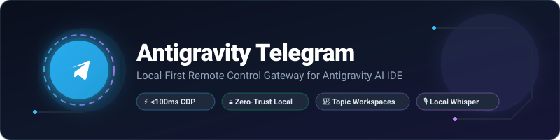
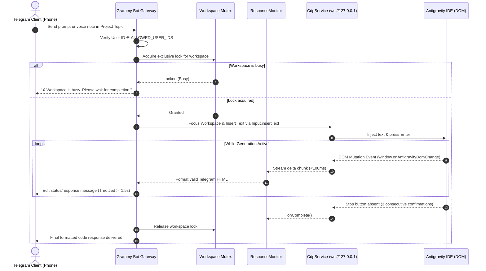

<div align="center">

  

  <br/><br/>

  <h1>🚀 Antigravity Telegram</h1>

  <p>
    <strong>Control your Antigravity AI IDE from anywhere — directly from Telegram.</strong><br>
    <em>A local-first, privacy-focused remote control gateway powered by the Chrome DevTools Protocol (CDP).</em>
  </p>

  <p>
    <a href="LICENSE"></a>
    
    
    
    <a href="docs/prd/README.md"></a>
    
  </p>

  <p>
    <a href="#-quick-start"><b>Quick Start</b></a> •
    <a href="#-key-capabilities"><b>Key Capabilities</b></a> •
    <a href="#️-command-reference"><b>Command Reference</b></a> •
    <a href="#️-architecture--interaction-flow"><b>Architecture</b></a> •
    <a href="#-technical-documentation-suite"><b>PRD Documentation</b></a>
  </p>

</div>

---

## 📖 Overview

**Antigravity Telegram (ANTIRLM)** is a lightweight, local-first bridge that connects your smartphone or any Telegram client directly to your desktop [Antigravity IDE](https://antigravity.dev).

Whether you are commuting, having coffee, or working away from your desk, Antigravity Telegram enables you to supervise long-running coding agents, review file edits, approve command executions, send voice notes, and receive real-time code output.

**100% Local & Private**: Unlike cloud-hosted relays, Antigravity Telegram runs entirely on your host machine. Telemetry, credentials, prompts, and source code never pass through external intermediate servers. The bot relies exclusively on outbound HTTPS long-polling to Telegram servers; zero inbound listening ports are exposed to the Internet.

```
+-----------------------------------------------------------------------------------------+
|                              ANTIGRAVITY TELEGRAM TOPOLOGY                              |
+-----------------------------------------------------------------------------------------+
|  [ Telegram App (Mobile / Desktop) ]                                                    |
|                 ^                                                                       |
|                 | Outbound HTTPS Long-Polling (getUpdates)                              |
|                 v                                                                       |
|  [ Local Workstation (100% Host Resident) ]                                             |
|    ├── 1. Gateway Tier    : Grammy Bot Engine + Whitelist Auth Guard                     |
|    ├── 2. Persistence Tier: SQLite Database (antigravity.db via BaseRepository)         |
|    ├── 3. Domain Engine   : Dual-Stream ResponseMonitor + ApprovalDetector              |
|    └── 4. CDP Bridge      : WebSocket ws://127.0.0.1 (Chrome DevTools Protocol)         |
|                 |                                                                       |
|                 v                                                                       |
|  [ Antigravity IDE (Chromium Renderer DOM) ]                                            |
|    └── Event-Driven MutationObserver (<100ms real-time updates)                         |
+-----------------------------------------------------------------------------------------+
```

---

## ✨ Key Capabilities

- **⚡ Event-Driven Real-Time Sync (<100ms)**  
  Leverages native browser `MutationObserver` bindings via CDP. Assistant outputs, tool calls, and status changes are captured in real-time with sub-100ms latency and minimal host CPU overhead (<1.0% when idle).

- **📂 Smart Forum Topic Workspace Routing**  
  In Telegram Supergroups, each project directory is bound to its own **Forum Topic**. Messages sent in a topic automatically preserve that repository's context, session state, and concurrency locks.

- **⏱️ Dual-Stream Progress Reporting**  
  Intelligently separates internal reasoning/tool logs (Thinking, File Diffs, Command Runs) from final assistant code responses. Updates are smoothly throttled to avoid Telegram rate-limit penalties.

- **🎙️ On-Device Voice Transcription (Local Whisper)**  
  Send voice notes directly from Telegram. Transcribed locally using [whisper.cpp](https://github.com/ggerganov/whisper.cpp) via `ffmpeg-static`. Audio data is processed in memory and never sent to external speech APIs.

- **✅ Remote Interactive Approvals**  
  When Antigravity requests confirmation for file modifications or terminal commands, you receive a diff preview with interactive buttons (`Approve`, `Reject`, `Auto-Accept`) right on your phone.

- **🛡️ Defense-in-Depth Security (Audited)**  
  - **Zero-Trust Whitelist**: Only authorized Telegram user IDs are processed; all unauthorized messages are dropped silently.
  - **Path Traversal Defense**: All paths are resolved with canonical `realpathSync` validation against `WORKSPACE_BASE_DIR`, preventing symlink escapes.
  - **Safe DOM Injection**: Prompts are inserted using native `Input.insertText`, eliminating JavaScript evaluation and template injection risks.
  - **Parameterized SQLite**: 100% prepared SQL statements, preventing SQL injection.

- **🧱 Clean Object-Oriented Architecture**  
  Built with reusable OOP patterns (`BaseRepository`, `BaseService`, `ICommandHandler`), making components maintainable and extensible across other developer bot projects.

---

## 🚀 Quick Start

### Prerequisites

- **Node.js**: `v18.0.0` or higher
- **Antigravity IDE**: Installed on host machine
- **Telegram Bot**: Created in 1 minute via [@BotFather](https://t.me/BotFather)

> [!NOTE]
> **macOS Users**: Ensure Xcode Command Line Tools are installed (`xcode-select --install`) to compile native C++ SQLite bindings (`better-sqlite3`).

### 1. Installation

#### Global Install via npm (Recommended)
```bash
npm install -g antigravity-telegram
```

#### Or Install from Source
```bash
git clone https://github.com/hongquandev/antigravity-telegram.git
cd antigravity-telegram
npm install
npm run build
```

### 2. Interactive Setup Wizard

Run the interactive setup wizard to configure your Telegram Bot Token, Allowed User IDs, and Workspace Root Directory:
```bash
antigravity-telegram setup
```

The configuration is saved securely to `.env` or `~/.config/antigravity-telegram-remote/config.json` with `600` file permissions.

### 3. Launch Antigravity with CDP Debugging

Antigravity Telegram interacts with Antigravity through its Chrome DevTools Protocol port. Launch Antigravity with debugging enabled:
```bash
antigravity-telegram open
```

### 4. Start the Telegram Bot

In your terminal, start the bot daemon:
```bash
antigravity-telegram start
```

> [!TIP]
> If you experience connection issues or want to verify your setup, run the diagnostic doctor:
> ```bash
> antigravity-telegram doctor
> ```

---

## ⌨️ Command Reference

### CLI Commands (Terminal)

| Command | Description |
| :--- | :--- |
| `antigravity-telegram setup` | Run the interactive setup and configuration wizard. |
| `antigravity-telegram open` | Scan available ports and launch Antigravity with CDP enabled. |
| `antigravity-telegram start` | Start the Telegram bot gateway. |
| `antigravity-telegram doctor` | Diagnose environment, Node version, CDP connectivity, and database health. |
| `antigravity-telegram --verbose` | Start with verbose debug-level logging. |

*(Note: `antigravity-telegram-remote` is supported as an alias for all CLI commands).*

### Telegram Slash Commands (Chat / Topic)

| Slash Command | Context | Description |
| :--- | :--- | :--- |
| `/project` | Topic / DM | Open interactive menu to select and bind a workspace to the current topic. |
| `/status` | Any | View active CDP connection, bound workspace, current AI model, and token quota. |
| `/new` | Topic / DM | Start a fresh conversational session in the bound workspace, clearing history. |
| `/chat` | Topic / DM | Browse and switch between previous chat sessions saved for this workspace. |
| `/screenshot` | Topic / DM | Capture an instant high-resolution PNG screenshot of the Antigravity IDE window. |
| `/model` | Any | Switch active AI model (Gemini Pro, Flash, Claude Sonnet, etc.) with 1 tap. |
| `/mode` | Any | Toggle operation modes (`Fast`, `Plan`, `Code`, `Ask`). |
| `/stop` | Topic / DM | Immediately halt the executing prompt or command in the bound workspace. |
| `/autoaccept` | Any | Configure auto-approval mode (`ALL`, `SAFE_ONLY`, `OFF`) for file edits and commands. |
| `/template` | Any | Manage and quickly inject reusable prompt templates from SQLite. |
| `/cleanup [days]`| Any | Purge inactive sessions and reclaim database storage (default: 30 days). |
| `/help` | Any | Display human-crafted cheat sheet and keyboard shortcuts. |

---

## 🏗️ Architecture & Interaction Flow



---

## 📚 Technical Documentation Suite

Antigravity Telegram maintains an exhaustive, modular technical documentation suite:

- **[Master Agent Guide (.agents/AGENTS.md)](.agents/AGENTS.md)**: Master engineering guide, OOP standards, threat models, contributor workflows, and maintenance rules.
- **[Product Requirements Document (PRD) Suite (docs/prd/)](docs/prd/README.md)**:
  - **[01. Overview & Objectives](docs/prd/01-overview-and-objectives.md)**: Vision, personas, problem statement, OKRs, and scope.
  - **[02. System Architecture](docs/prd/02-system-architecture.md)**: 3-tier design, CDP WebSocket engine, and Event-Driven DOM pipeline.
  - **[03. Functional Specifications](docs/prd/03-functional-specifications.md)**: Slash commands, Forum Topic isolation, streaming, and approvals.
  - **[04. Security Architecture & Threat Model](docs/prd/04-security-and-threat-model.md)**: Complete CWE/OWASP defense matrix and zero-trust guidelines.
  - **[05. Data Architecture & Persistence](docs/prd/05-data-design-and-storage.md)**: SQLite schemas, prepared statement caching, and lockfiles.
  - **[06. UX & Non-AI-Slop Interface Design](docs/prd/06-user-experience-and-interface.md)**: Human-crafted design charter, visual hierarchy, and error UX.
  - **[07. OOP Architecture & Reusability](docs/prd/07-oop-design-and-reusability.md)**: BaseRepository, BaseService, and reusable command patterns.
  - **[08. Testing Strategy & QA](docs/prd/08-testing-and-quality-assurance.md)**: Jest testing pyramid, mock CDP fixtures, and verification checklist.
  - **[09. Maintenance & Documentation Policy](docs/prd/09-maintenance-and-evolution-rules.md)**: Mandatory auto-update rules for code and documentation.

---

## ⚙️ Configuration Reference

Configuration options can be supplied via environment variables (`.env`) or JSON config (`config.json`):

| Variable | Type | Default | Description |
| :--- | :--- | :--- | :--- |
| `TELEGRAM_BOT_TOKEN` | `string` | **Required** | Secret token obtained from Telegram @BotFather. |
| `ALLOWED_USER_IDS` | `string` | **Required** | Comma-separated list of numerical Telegram User IDs allowed to access the bot. |
| `WORKSPACE_BASE_DIR` | `string` | `~/Code` | Root directory containing your development repositories. |
| `USE_TOPICS` | `boolean` | `true` | Map individual workspaces to dedicated Telegram Forum Topics. |
| `AUTO_APPROVE_FILE_EDITS` | `string`| `OFF` | Auto-approval policy (`OFF`, `SAFE_ONLY`, `ALL`). |
| `ANTIGRAVITY_PATH` | `string` | Auto-detected | Explicit path to the Antigravity executable. |
| `LOG_LEVEL` | `string` | `info` | Logging verbosity (`debug`, `info`, `warn`, `error`). |

---

## 🔒 Mandatory Documentation Auto-Update Policy

> [!IMPORTANT]
> **Strict Repository Rule**:  
> Whenever any feature, command, configuration variable, database schema, or architectural component in this repository is modified, **the corresponding documentation in `docs/prd/` and this `README.md` MUST be updated in the exact same turn or commit**. Outdated documentation is treated as a critical regression.

---

## 🤝 Contributing

We welcome community contributions! Please adhere to our development standards:

1. Fork the repository and create your feature branch (`git checkout -b feature/my-feature`).
2. Write clean TypeScript code conforming to the OOP principles in `src/database/baseRepository.ts` and `src/services/baseService.ts`.
3. Verify all tests pass and compilation succeeds:
   ```bash
   npm test
   npm run build
   ```
4. Update the relevant PRD documents in `docs/prd/` and `README.md`.
5. Submit a detailed Pull Request.

Detailed guidelines, code conventions, and our Code of Conduct are maintained in **[.agents/AGENTS.md](.agents/AGENTS.md)**.

---

## 📄 License

This project is licensed under the terms of the [MIT License](LICENSE).

---

## 🙏 Acknowledgements

Antigravity Telegram originated from and inherits foundational architectural concepts from **[optimistengineer/remoat](https://github.com/optimistengineer/remoat)**.

We express our gratitude to the original creators. Building upon that foundation, this version has been audited, overhauled, and expanded by **Quan Nguyen - TNM**:
- Migrated to an **Event-Driven (`MutationObserver` + CDP Binding)** pipeline achieving <100ms updates and low CPU usage.
- Hardened security via **`realpathSync` canonical path resolution** to eliminate symlink path traversal vulnerabilities.
- Modernized the codebase with a **Reusable Object-Oriented Architecture** (`BaseRepository`, `BaseService`, `CommandRegistry`).
- Integrated **On-Device Whisper** speech-to-text and rich image attachment handling.
- Implemented complete internationalization (`en`, `vi`, `ja`).
