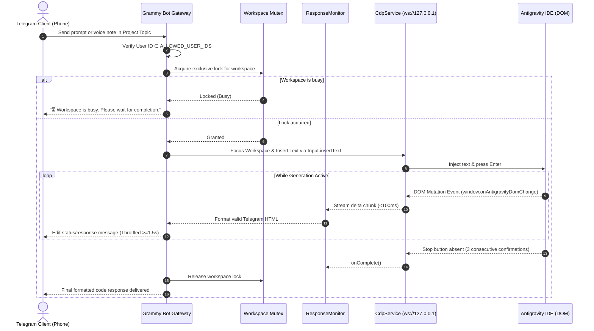

<div align="center">

  <a href="https://github.com/denoyey/antigravity-telegram"></a>

  <br/><br/>

  <h1>🚀 Antigravity Telegram</h1>

  <p>
    <strong>Control your Antigravity AI IDE from anywhere — directly from Telegram.</strong><br>
    <em>A local-first, privacy-focused remote control gateway powered by the Chrome DevTools Protocol (CDP).</em>
  </p>

  <p>
    <a href="LICENSE"></a>
    
    
    
    <a href="docs/prd/README.md"></a>
    
  </p>

  <p>
    <a href="#-quick-start"><b>Quick Start</b></a> •
    <a href="#-key-capabilities"><b>Key Capabilities</b></a> •
    <a href="#️-command-reference"><b>Command Reference</b></a> •
    <a href="#️-architecture--interaction-flow"><b>Architecture</b></a> •
    <a href="#-technical-documentation-suite"><b>PRD Documentation</b></a>
  </p>

</div>

---

## 📖 Overview

**Antigravity Telegram** is a lightweight, local-first bridge that connects your smartphone or any Telegram client directly to your desktop [Antigravity IDE](https://antigravity.dev).

Whether you are commuting, having coffee, or working away from your desk, Antigravity Telegram enables you to supervise long-running coding agents, review file edits, approve command executions, send voice notes, and receive real-time code output.

**100% Local & Private**: Unlike cloud-hosted relays, Antigravity Telegram runs entirely on your host machine. Telemetry, credentials, prompts, and source code never pass through external intermediate servers. The bot relies exclusively on outbound HTTPS long-polling to Telegram servers; zero inbound listening ports are exposed to the Internet.

```
+-----------------------------------------------------------------------------------------+
|                              ANTIGRAVITY TELEGRAM TOPOLOGY                              |
+-----------------------------------------------------------------------------------------+
|  [ Telegram App (Mobile / Desktop) ]                                                    |
|                 ^                                                                       |
|                 | Outbound HTTPS Long-Polling (getUpdates)                              |
|                 v                                                                       |
|  [ Local Workstation (100% Host Resident) ]                                             |
|    ├── 1. Gateway Tier    : Grammy Bot Engine + Whitelist Auth Guard                     |
|    ├── 2. Persistence Tier: SQLite Database (antigravity.db via BaseRepository)         |
|    ├── 3. Domain Engine   : Dual-Stream ResponseMonitor + ApprovalDetector              |
|    └── 4. CDP Bridge      : WebSocket ws://127.0.0.1 (Chrome DevTools Protocol)         |
|                 |                                                                       |
|                 v                                                                       |
|  [ Antigravity IDE (Chromium Renderer DOM) ]                                            |
|    └── Event-Driven MutationObserver (<100ms real-time updates)                         |
+-----------------------------------------------------------------------------------------+
```

---

## ✨ Key Capabilities

- **⚡ Event-Driven Real-Time Sync (<100ms)**  
  Leverages native browser `MutationObserver` bindings via CDP. Assistant outputs, tool calls, and status changes are captured in real-time with sub-100ms latency and minimal host CPU overhead (<1.0% when idle).

- **📂 Smart Forum Topic Workspace Routing**  
  In Telegram Supergroups, each project directory is bound to its own **Forum Topic**. Messages sent in a topic automatically preserve that repository's context, session state, and concurrency locks.

- **⏱️ Dual-Stream Progress Reporting**  
  Intelligently separates internal reasoning/tool logs (Thinking, File Diffs, Command Runs) from final assistant code responses. Updates are smoothly throttled to avoid Telegram rate-limit penalties.

- **🎙️ On-Device Voice Transcription (Local Whisper)**  
  Send voice notes directly from Telegram. Transcribed locally using [whisper.cpp](https://github.com/ggerganov/whisper.cpp) via `ffmpeg-static`. Audio data is processed in memory and never sent to external speech APIs.

- **✅ Remote Interactive Approvals**  
  When Antigravity requests confirmation for file modifications or terminal commands, you receive a diff preview with interactive buttons (`Approve`, `Reject`, `Auto-Accept`) right on your phone.

- **🛡️ Defense-in-Depth Security (Audited)**  
  - **Zero-Trust Whitelist**: Only authorized Telegram user IDs are processed; all unauthorized messages are dropped silently.
  - **Path Traversal Defense**: All paths are resolved with canonical `realpathSync` validation against `WORKSPACE_BASE_DIR`, preventing symlink escapes.
  - **Safe DOM Injection**: Prompts are inserted using native `Input.insertText`, eliminating JavaScript evaluation and template injection risks.
  - **Parameterized SQLite**: 100% prepared SQL statements, preventing SQL injection.

- **🧱 Clean Object-Oriented Architecture**  
  Built with reusable OOP patterns (`BaseRepository`, `BaseService`, `ICommandHandler`), making components maintainable and extensible across other developer bot projects.

---

## 🚀 Quick Start

### Prerequisites

- **Node.js**: `v18.0.0` or higher
- **Antigravity IDE**: Installed on your workstation
- **Telegram Bot**: Created via [@BotFather](https://t.me/BotFather) (see guide below)

> [!NOTE]
> **macOS Users**: Ensure Xcode Command Line Tools are installed (`xcode-select --install`) to compile native C++ SQLite bindings (`better-sqlite3`).

---

### 1. Telegram Bot Setup (3-Minute Setup)

Before running the CLI, you need your **Telegram Bot Token** and **User ID**:

#### Step 1: Create Your Bot with [@BotFather](https://t.me/BotFather)
1. Open Telegram, search for [@BotFather](https://t.me/BotFather), and tap **Start**.
2. Send `/newbot` to create a new bot instance.
3. Choose a display name (e.g., `My Antigravity IDE`).
4. Choose a unique username ending in `bot` (e.g., `my_antigravity_remote_bot`).
5. BotFather will reply with your **HTTP API Token** (format: `1234567890:ABCdefGHIjklMNOpqrsTUVwxyz`). Copy and save this token.

#### Step 2: Get Your Telegram User ID with [@userinfobot](https://t.me/userinfobot)
1. In Telegram, search for [@userinfobot](https://t.me/userinfobot) and tap **Start**.
2. The bot will reply with your account details. Copy the numeric **`Id`** (e.g., `987654321`).
3. This ID will be your `ALLOWED_USER_IDS`. Due to zero-trust architecture, any message from an unauthorized ID is silently dropped.

#### Step 3 (Recommended): Setup Forum Topics in a Telegram Group
For the best multi-workspace experience:
1. Create a new Telegram Group (e.g., `My Workspaces`) and add your bot.
2. In Group Settings $\rightarrow$ Turn ON **"Topics"** (Forum Topics).
3. Promote your bot to **Administrator** with permission to **Manage Topics** and **Delete Messages**.
> Each project folder in your development directory will now automatically correspond to its own isolated Forum Topic thread!

#### Step 4: Register Mobile Slash Command Menu
To enable instant autocomplete when typing `/` on your phone:
1. Send `/setcommands` to [@BotFather](https://t.me/BotFather) and select your bot.
2. Copy and paste the following command list:
```text
project - Switch and bind workspace folder to this topic
status - Check CDP connection, active model, and quota
new - Start a fresh chat session in current workspace
chat - Browse and restore previous chat sessions
screenshot - Capture instant screenshot of Antigravity IDE
model - Switch AI model (Gemini Pro, Flash, Claude, etc.)
mode - Toggle operation mode (Fast, Plan, Code, Ask)
stop - Halt executing prompt in this workspace
autoaccept - Configure auto-approval for edits and commands
template - Insert reusable prompt templates from SQLite
cleanup - Purge inactive sessions and reclaim storage
help - View command guide and keyboard shortcuts
```

---

### 2. Installation & Execution Methods

You can run Antigravity Telegram in three different ways:

#### Option A: Zero-Install via npx (Quickest)
No prior installation required. Run directly on-demand:
```bash
npx antigravity-telegram setup
npx antigravity-telegram open
npx antigravity-telegram start
```

#### Option B: Global Install via npm (Recommended)
Install once to have the CLI command available everywhere in your terminal:
```bash
npm install -g antigravity-telegram

# Then run anytime:
antigravity-telegram setup
antigravity-telegram open
antigravity-telegram start
```

#### Option C: From Source (Developers / Local Clone)
Clone the repository to develop, customize, or contribute:
```bash
git clone https://github.com/denoyey/antigravity-telegram.git
cd antigravity-telegram
npm install
npm run build

# Run commands via npm scripts:
npm run setup
npm run open
npm start        # or npm run dev (hot-reload mode)
```

---

### 2. Step-by-Step Running Guide

#### Step 1: Run Interactive Setup
Configure your Telegram Bot Token, User ID Whitelist, and Base Workspace Directory:
```bash
# Global
antigravity-telegram setup

# Or via npx
npx antigravity-telegram setup

# Or from source
npm run setup
```
> The configuration is saved securely to `.env` or `~/.config/antigravity-telegram-remote/config.json` with restricted `600` permissions.

#### Step 2: Launch Antigravity IDE with Remote Debugging
Antigravity Telegram communicates with the desktop IDE via Chrome DevTools Protocol (CDP). Launch your IDE with CDP enabled:
```bash
# Global
antigravity-telegram open

# Or via npx
npx antigravity-telegram open

# Or from source
npm run open
```

#### Step 3: Start the Telegram Bot Daemon
Boot up the long-polling bot gateway:
```bash
# Global
antigravity-telegram start

# Or via npx
npx antigravity-telegram start

# Or from source
npm start            # Standard run
npm run dev          # Development mode with hot-reload
```

#### Step 4: Verify Environment & Connectivity (Doctor)
If you encounter any issues or want to verify that your environment, Node version, and CDP ports are responding:
```bash
# Global
antigravity-telegram doctor

# Or via npx
npx antigravity-telegram doctor

# Or from source
npm run doctor
```

---

## ⌨️ Command Reference

### CLI Running Commands Matrix

| Task / Action | Global CLI (`npm i -g`) | On-Demand (`npx`) | From Source (`git clone`) | Description |
| :--- | :--- | :--- | :--- | :--- |
| **Interactive Setup** | `antigravity-telegram setup` | `npx antigravity-telegram setup` | `npm run setup` | Launches configuration wizard for Bot Token & Whitelist. |
| **Launch IDE (CDP)** | `antigravity-telegram open` | `npx antigravity-telegram open` | `npm run open` | Starts Antigravity IDE with remote debugging port active. |
| **Start Bot Gateway** | `antigravity-telegram start` | `npx antigravity-telegram start` | `npm start` *(or `npm run dev`)* | Boots the bot long-polling process and event listeners. |
| **Diagnostic Doctor** | `antigravity-telegram doctor` | `npx antigravity-telegram doctor` | `npm run doctor` | Verifies Node.js, config, SQLite, and CDP WebSocket health. |
| **Debug Logging** | `antigravity-telegram --verbose` | `npx antigravity-telegram --verbose` | `npm start -- --verbose` | Displays detailed debug logs for CDP and DOM monitoring. |
| **Run Unit Tests** | — | — | `npm test` | Runs 71 Jest test suites (711 unit/integration tests). |
| **Compile Source** | — | — | `npm run build` | Compiles TypeScript (`src/`) into distribution (`dist/`). |

*(Note: `antigravity-telegram-remote` is supported as an identical alias for all CLI commands).*

### Telegram Slash Commands (Chat / Topic)

| Slash Command | Context | Description |
| :--- | :--- | :--- |
| `/project` | Topic / DM | Open interactive menu to select and bind a workspace to the current topic. |
| `/status` | Any | View active CDP connection, bound workspace, current AI model, and token quota. |
| `/new` | Topic / DM | Start a fresh conversational session in the bound workspace, clearing history. |
| `/chat` | Topic / DM | Browse and switch between previous chat sessions saved for this workspace. |
| `/screenshot` | Topic / DM | Capture an instant high-resolution PNG screenshot of the Antigravity IDE window. |
| `/model` | Any | Switch active AI model (Gemini Pro, Flash, Claude Sonnet, etc.) with 1 tap. |
| `/mode` | Any | Toggle operation modes (`Fast`, `Plan`, `Code`, `Ask`). |
| `/stop` | Topic / DM | Immediately halt the executing prompt or command in the bound workspace. |
| `/autoaccept` | Any | Configure auto-approval mode (`ALL`, `SAFE_ONLY`, `OFF`) for file edits and commands. |
| `/template` | Any | Manage and quickly inject reusable prompt templates from SQLite. |
| `/cleanup [days]`| Any | Purge inactive sessions and reclaim database storage (default: 30 days). |
| `/help` | Any | Display human-crafted cheat sheet and keyboard shortcuts. |

---

## 🏗️ Architecture & Interaction Flow



---

## 📚 Technical Documentation Suite

Antigravity Telegram maintains an exhaustive, modular technical documentation suite:

- **[Master Agent Guide (.agents/AGENTS.md)](.agents/AGENTS.md)**: Master engineering guide, OOP standards, threat models, contributor workflows, and maintenance rules.
- **[Product Requirements Document (PRD) Suite (docs/prd/)](docs/prd/README.md)**:
  - **[01. Overview & Objectives](docs/prd/01-overview-and-objectives.md)**: Vision, personas, problem statement, OKRs, and scope.
  - **[02. System Architecture](docs/prd/02-system-architecture.md)**: 3-tier design, CDP WebSocket engine, and Event-Driven DOM pipeline.
  - **[03. Functional Specifications](docs/prd/03-functional-specifications.md)**: Slash commands, Forum Topic isolation, streaming, and approvals.
  - **[04. Security Architecture & Threat Model](docs/prd/04-security-and-threat-model.md)**: Complete CWE/OWASP defense matrix and zero-trust guidelines.
  - **[05. Data Architecture & Persistence](docs/prd/05-data-design-and-storage.md)**: SQLite schemas, prepared statement caching, and lockfiles.
  - **[06. UX & Non-AI-Slop Interface Design](docs/prd/06-user-experience-and-interface.md)**: Human-crafted design charter, visual hierarchy, and error UX.
  - **[07. OOP Architecture & Reusability](docs/prd/07-oop-design-and-reusability.md)**: BaseRepository, BaseService, and reusable command patterns.
  - **[08. Testing Strategy & QA](docs/prd/08-testing-and-quality-assurance.md)**: Jest testing pyramid, mock CDP fixtures, and verification checklist.
  - **[09. Maintenance & Documentation Policy](docs/prd/09-maintenance-and-evolution-rules.md)**: Mandatory auto-update rules for code and documentation.

---

## ⚙️ Configuration Reference

Configuration options can be supplied via environment variables (`.env`) or JSON config (`config.json`):

| Variable | Type | Default | Description |
| :--- | :--- | :--- | :--- |
| `TELEGRAM_BOT_TOKEN` | `string` | **Required** | Secret token obtained from Telegram @BotFather. |
| `ALLOWED_USER_IDS` | `string` | **Required** | Comma-separated list of numerical Telegram User IDs allowed to access the bot. |
| `WORKSPACE_BASE_DIR` | `string` | `~/Code` | Root directory containing your development repositories. |
| `USE_TOPICS` | `boolean` | `true` | Map individual workspaces to dedicated Telegram Forum Topics. |
| `AUTO_APPROVE_FILE_EDITS` | `string`| `OFF` | Auto-approval policy (`OFF`, `SAFE_ONLY`, `ALL`). |
| `ANTIGRAVITY_PATH` | `string` | Auto-detected | Explicit path to the Antigravity executable. |
| `LOG_LEVEL` | `string` | `info` | Logging verbosity (`debug`, `info`, `warn`, `error`). |

---

## 🔒 Mandatory Documentation Auto-Update Policy

> [!IMPORTANT]
> **Strict Repository Rule**:  
> Whenever any feature, command, configuration variable, database schema, or architectural component in this repository is modified, **the corresponding documentation in `docs/prd/` and this `README.md` MUST be updated in the exact same turn or commit**. Outdated documentation is treated as a critical regression.

---

## 🤝 Contributing

We welcome community contributions! Please adhere to our development standards:

1. Fork the repository and create your feature branch (`git checkout -b feature/my-feature`).
2. Write clean TypeScript code conforming to the OOP principles in `src/database/baseRepository.ts` and `src/services/baseService.ts`.
3. Verify all tests pass and compilation succeeds:
   ```bash
   npm test
   npm run build
   ```
4. Update the relevant PRD documents in `docs/prd/` and `README.md`.
5. Submit a detailed Pull Request.
6. Releases are automatically published to npm via GitHub Actions using OIDC Trusted Publishing (`.github/workflows/publish.yml`).

Detailed guidelines, code conventions, and our Code of Conduct are maintained in **[.agents/AGENTS.md](.agents/AGENTS.md)**.

---

## 📄 License

This project is licensed under the terms of the [MIT License](LICENSE).

---

## 🙏 Acknowledgements & Attribution

<div align="center">

> ### 💖 Special Thanks to the Original Creator
>
> This project proudly builds upon the pioneering architecture of **[optimistengineer/remoat](https://github.com/optimistengineer/remoat)**.  
> We express our heartfelt gratitude to the original creators and contributors for innovating the core concept of controlling desktop AI coding assistants through the Chrome DevTools Protocol and Telegram.

</div>

### 🌟 Lineage & Engineering Evolution

```
[ optimistengineer/remoat ] ──► Foundational Concept: Local CDP Bridge & Telegram Gateway
             │
             ▼
[ Antigravity Telegram (denoyey) ] ──► Audited, Overhauled & Modular Architecture
```

| Architecture Area | Upstream Foundation (`remoat`) | Antigravity Telegram Enhancement |
| :--- | :--- | :--- |
| **DOM Synchronization** | 2-second polling intervals | **Event-Driven `MutationObserver`** + CDP Binding (`<100ms` instant delta updates) |
| **Path Traversal Security**| Standard path normalization | **Canonical `realpathSync`** resolution (hardened defense against symlink escapes) |
| **Software Architecture** | Flat procedural handlers | **Modular OOP Architecture** (`BaseRepository`, `BaseService`, `CommandRegistry`) |
| **Audio & Voice Support** | Text only | **On-Device Whisper (`whisper.cpp`)** local voice transcription (zero cloud leakage) |
| **Visual Attachments** | Text prompts only | **Screenshot streaming** & direct image upload injection into Antigravity IDE |
| **Documentation Suite** | Basic README | **Comprehensive 10-Module PRD Suite** + Master Agent Guide (`.agents/AGENTS.md`) |
| **Internationalization** | Basic locales | **Full Multi-Language Support** (`en`, `vi`, `ja`) with unified i18n engine |

> [!TIP]
> If you find this project useful, please take a moment to also star and support the original upstream repository at **[github.com/optimistengineer/remoat](https://github.com/optimistengineer/remoat)**!
