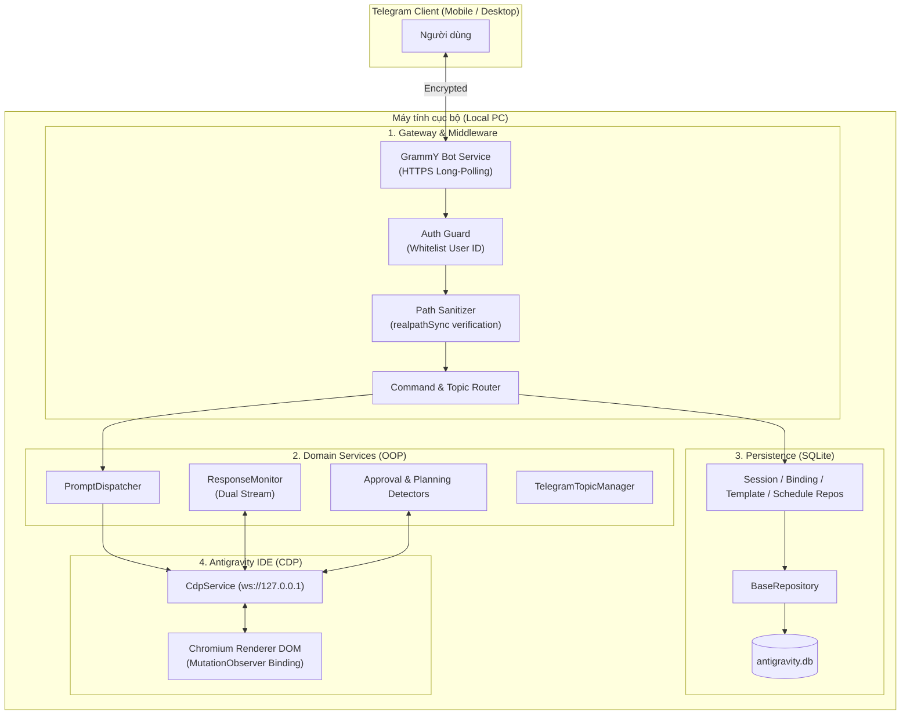

# 🚀 ANTIRLM (Antigravity Telegram Remote)

<p align="center">
  <pre>
    ___     _   _  _____  ___  ____  ___     _  _ 
   / _ \   | \ | ||_   _||_ _||  _ \|_ _|   | \/ |
  / /_\ \  |  \| |  | |   | | | |_) || |    |    |
 / /   \ \ | |\  |  | |   | | |  _ < | |    | || |
/_/     \_\|_| \_|  |_|  |___||_| \_\|___|  |_||_|

           QUAN NGUYEN - TNM
  </pre>
  <strong>Điều khiển trợ lý lập trình AI của bạn từ bất cứ đâu — ngay từ Telegram.</strong><br>
  <em>Control your Antigravity AI coding assistant from anywhere via Telegram.</em>
</p>

<p align="center">
  <a href="LICENSE"></a>
  
  
  
  <a href="docs/prd/README.md"></a>
</p>

---

**ANTIRLM** (Antigravity-Telegram-Remote) là một **Telegram Bot cục bộ (local-first)** mạnh mẽ, cho phép bạn điều khiển từ xa IDE [Antigravity](https://antigravity.dev) trên PC — từ điện thoại, máy tính bảng hoặc bất cứ thiết bị nào có Telegram.

Chỉ cần gõ hướng dẫn bằng ngôn ngữ tự nhiên, đính kèm ảnh chụp màn hình hoặc gửi tin nhắn thoại (voice note). ANTIRLM sẽ chuyển tiếp đến Antigravity qua Chrome DevTools Protocol (CDP), giám sát tiến trình thực tế theo thời gian thực và phản hồi kết quả trực tiếp về Telegram. **100% dữ liệu, mã nguồn và API token đều nằm an toàn trên máy tính của bạn.**

---

## 🌟 Tính năng nổi bật (Key Features)

*   **🕹️ Điều khiển từ xa 24/7 (Remote Operation):** Gửi lời nhắc (prompt), hình ảnh hoặc voice message từ smartphone. Antigravity thực thi trên PC của bạn với toàn bộ sức mạnh phần cứng cục bộ.
*   **📂 Quản lý dự án thông minh (Forum Topic Routing):** Mỗi dự án được tự động ánh xạ tới một **Telegram Forum Topic**. Mọi tin nhắn trong topic tự động đồng bộ ngữ cảnh dự án và lịch sử phiên làm việc riêng biệt.
*   **⏱️ Theo dõi tiến độ trực tiếp (Dual-Stream Progress):** Phân tách thông minh giữa luồng suy nghĩ/nhật ký công cụ (Thinking, Edit file, Run command) và luồng kết quả mã nguồn hoàn thiện.
*   **🎙️ Hỗ trợ giọng nói cục bộ (Local Whisper):** Ghi âm và gửi voice note. ANTIRLM dịch giọng nói ngay trên máy qua `whisper.cpp` — hoàn toàn ngoại tuyến, không gửi âm thanh lên bất kỳ đám mây nào.
*   **✅ Phê duyệt từ xa (Remote Approvals):** Khi Antigravity cần xác nhận sửa file hoặc chạy lệnh terminal, bạn nhận được diff preview và nút bấm phê duyệt (`Approve` / `Reject`) ngay trong Telegram.
*   **⚡ Tối ưu Event-Driven (<100ms Updates):** Kết hợp `MutationObserver` và `CDP Binding` để bắt sự kiện thay đổi DOM tức thì, mượt mà và tiết kiệm CPU vượt trội (<1.0% khi nhàn rỗi).
*   **🛡️ Bảo mật chuẩn Zero-Trust (Audited Defense-in-Depth):**
    *   **Whitelist User ID**: Chỉ người dùng được cấu hình mới có quyền tương tác; mọi tin nhắn lạ bị hủy bỏ hoàn toàn.
    *   **Chống Path Traversal**: Sử dụng giải thuật `realpathSync` ngăn chặn tuyệt đối các kỹ thuật bypass qua symlink hoặc đường dẫn tương đối.
    *   **Chống Injection**: Sử dụng `Input.insertText` và truy vấn SQLite tham số hóa (`?`), triệt tiêu nguy cơ Script Injection và SQL Injection.
    *   **Không mở cổng mạng**: Bot hoạt động qua HTTPS Long-Polling chiều đi, kết nối CDP chỉ lắng nghe trên `127.0.0.1`.
*   **🧱 Kiến trúc OOP Module hóa (Clean & Reusable):** Sử dụng `BaseRepository` cho toàn bộ tầng dữ liệu SQLite, `BaseService` cho domain services, và `ICommandHandler` cho hệ thống lệnh, dễ dàng mở rộng và tái sử dụng cho các dự án bot khác.

---

## 🛠️ Cài đặt nhanh (Quick Start)

### Yêu cầu hệ thống
*   [Node.js](https://nodejs.org/) 18.x trở lên.
*   [Antigravity IDE](https://antigravity.dev) đã được cài đặt trên máy.
*   Một bot Telegram (tạo miễn phí trong 1 phút qua [@BotFather](https://t.me/BotFather)).

> [!NOTE]
> **Người dùng macOS:** Cần cài đặt Xcode Command Line Tools (`xcode-select --install`) để biên dịch module C++ `better-sqlite3`.

### 1. Cài đặt toàn cục (Global Install)
```bash
npm install -g antigravity-telegram-remote
```
*Hoặc cài đặt từ mã nguồn:*
```bash
git clone https://github.com/hongquandev/antigravity-telegram-remote.git
cd antigravity-telegram-remote
npm install
npm run build
```

### 2. Thiết lập cấu hình (Setup Wizard)
Chạy lệnh sau và làm theo hướng dẫn tương tác để nhập Bot Token, User ID của bạn và thư mục dự án:
```bash
antigravity-telegram-remote setup
```

### 3. Khởi động Antigravity với cổng CDP
```bash
antigravity-telegram-remote open
```

### 4. Bắt đầu Bot (Run Bot)
```bash
antigravity-telegram-remote start
```

> [!TIP]
> Nếu cần kiểm tra môi trường, kết nối CDP hoặc cổng mạng, hãy chạy:
> ```bash
> antigravity-telegram-remote doctor
> ```

---

## ⌨️ Bảng lệnh điều khiển (Commands Reference)

### Lệnh CLI (Terminal)

| Lệnh | Chức năng |
| :--- | :--- |
| `antigravity-telegram-remote setup` | Chạy trình hướng dẫn cấu hình ban đầu tương tác. |
| `antigravity-telegram-remote open` | Tự động dò cổng và mở Antigravity IDE ở chế độ CDP debug. |
| `antigravity-telegram-remote start` | Khởi chạy tiến trình bot Telegram. |
| `antigravity-telegram-remote doctor` | Tự động kiểm tra sức khỏe hệ thống, Node.js, CDP và SQLite. |
| `antigravity-telegram-remote --verbose`| Xem log chi tiết cấp độ debug. |

### Lệnh Telegram (Chat / Topic)

| Lệnh | Mô tả chi tiết |
| :--- | :--- |
| `/project` | Mở danh sách bàn phím nút bấm các dự án để gắn vào topic hiện tại. |
| `/status` | Kiểm tra kết nối CDP, workspace đang hoạt động, model và quota còn lại. |
| `/new` | Khởi tạo phiên làm việc mới trong Antigravity, dọn dẹp ngữ cảnh cũ. |
| `/chat` | Xem danh sách và chuyển đổi giữa các phiên làm việc đã lưu trong dự án. |
| `/screenshot` | Chụp ảnh màn hình giao diện Antigravity IDE gửi về điện thoại ngay lập tức. |
| `/model` | Chuyển đổi Model AI (Gemini Pro, Flash, Claude Sonnet...) chỉ bằng 1 chạm. |
| `/mode` | Chuyển đổi chế độ hoạt động (Fast / Plan / Code / Ask). |
| `/stop` | Dừng khẩn cấp câu lệnh đang chạy trong workspace của topic. |
| `/autoaccept` | Bật/tắt chế độ tự động phê duyệt chỉnh sửa file (`ALL`, `SAFE_ONLY`, `OFF`). |
| `/template` | Quản lý và sử dụng các mẫu prompt soạn sẵn từ cơ sở dữ liệu SQLite. |
| `/cleanup [ngày]` | Dọn dẹp các session cũ và giải phóng dung lượng cơ sở dữ liệu. |
| `/help` | Xem danh sách hướng dẫn và phím tắt tiện ích. |

---

## 🏗️ Kiến trúc & Thiết kế hệ thống (Architecture)



---

## 📚 Hệ thống tài liệu (Documentation Suite)

Dự án duy trì bộ tài liệu kỹ thuật hoàn chỉnh và cập nhật liên tục:

- **[Master Agent Guide (.agents/AGENTS.md)](.agents/AGENTS.md)**: Hướng dẫn kỹ thuật toàn diện, quy chuẩn code, bảo mật, đóng góp và quy tắc đồng bộ bắt buộc cho AI Agents và lập trình viên.
- **[PRD Suite (docs/prd/)](docs/prd/README.md)**:
  - [01. Tổng quan & Mục tiêu (Overview & Objectives)](docs/prd/01-overview-and-objectives.md)
  - [02. Kiến trúc hệ thống (System Architecture)](docs/prd/02-system-architecture.md)
  - [03. Đặc tả tính năng (Functional Specs)](docs/prd/03-functional-specifications.md)
  - [04. Mô hình bảo mật & Đe dọa (Security & Threat Model)](docs/prd/04-security-and-threat-model.md)
  - [05. Thiết kế dữ liệu & Lưu trữ (Data Design & Storage)](docs/prd/05-data-design-and-storage.md)
  - [06. Trải nghiệm người dùng & Giao diện (UX & Non-AI-Slop)](docs/prd/06-user-experience-and-interface.md)
  - [07. Kiến trúc OOP & Khả năng tái sử dụng (OOP Design)](docs/prd/07-oop-design-and-reusability.md)
  - [08. Kiểm thử & Đảm bảo chất lượng (QA & Testing)](docs/prd/08-testing-and-quality-assurance.md)
  - [09. Quy tắc bảo trì & Đồng bộ tài liệu (Maintenance Rules)](docs/prd/09-maintenance-and-evolution-rules.md)

---

## 🔒 Quy tắc bảo trì & Tự động cập nhật tài liệu

> [!IMPORTANT]
> **Quy định bất khả xâm phạm đối với mọi Agent và Contributor**:
> Bất cứ khi nào có thay đổi về tính năng, lệnh, kiến trúc, tham số cấu hình hoặc cấu trúc cơ sở dữ liệu, **tài liệu tương ứng trong `docs/prd/` và `README.md` PHẢI được cập nhật ngay trong cùng một lượt (turn/commit)**. Tuyệt đối không để tài liệu bị lạc hậu so với mã nguồn thực tế.

---

## 🤝 Đóng góp (Contributing)

Mọi đóng góp từ cộng đồng đều được trân trọng. Quy trình đóng góp, tiêu chuẩn phong cách mã nguồn và cam kết đạo đức (Code of Conduct) được quy định chi tiết tại **[.agents/AGENTS.md](.agents/AGENTS.md)**.

1. Fork repository và tạo nhánh mới (`git checkout -b feature/tinh-nang-moi`).
2. Viết mã theo chuẩn TypeScript nghiêm ngặt và kiến trúc OOP kế thừa `BaseRepository` / `BaseService`.
3. Kiểm tra toàn bộ test: `npm test` và `npm run build`.
4. Cập nhật tài liệu liên quan trong `docs/prd/` và `README.md`.
5. Mở Pull Request.

---

## 📄 Giấy phép (License)

Dự án được phân phối theo giấy phép [MIT License](LICENSE).

---

## 🙏 Lời cảm ơn (Acknowledgements)

Dự án được khởi đầu và kế thừa kiến trúc nền tảng từ dự án mã nguồn mở **[optimistengineer/remoat](https://github.com/optimistengineer/remoat)**. 

Xin gửi lời cảm ơn chân thành đến đội ngũ tác giả ban đầu. Từ nền tảng đó, phiên bản ANTIRLM này đã được **Quan Nguyen - TNM** nghiên cứu, audit bảo mật và nâng cấp:
- Chuyển đổi sang cơ chế **Event-Driven (MutationObserver + CDP Binding)** cho tốc độ phản hồi DOM dưới 100ms.
- Thắt chặt bảo mật bằng giải thuật **realpathSync** chống tấn công Path Traversal qua symlink.
- Module hóa kiến trúc theo chuẩn **OOP (BaseRepository, BaseService, CommandRegistry)** giúp code dễ bảo trì và tái sử dụng.
- Đa dạng hóa đầu vào với **Local Whisper** và đính kèm hình ảnh.
- Bản địa hóa hoàn chỉnh đa ngôn ngữ (Tiếng Việt, Tiếng Anh, Tiếng Nhật).
