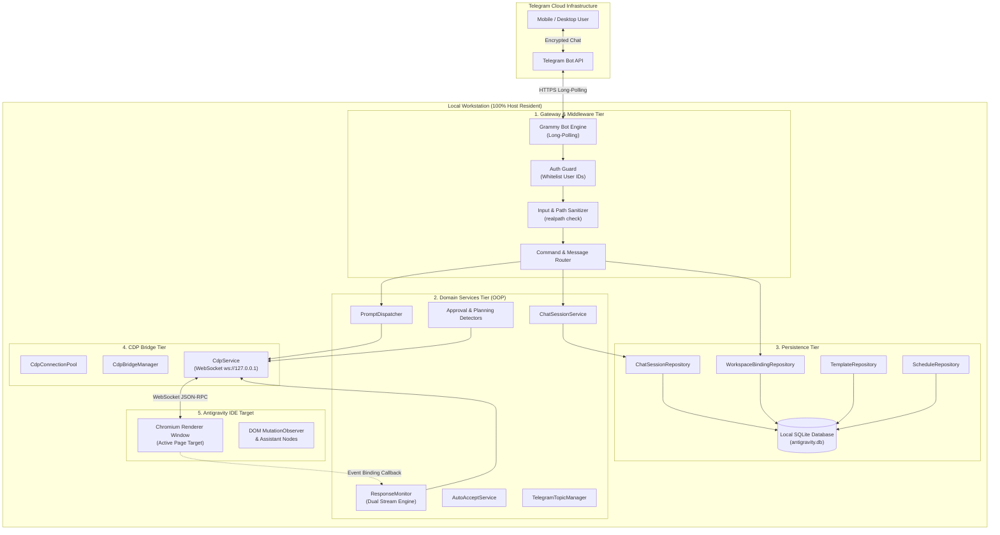
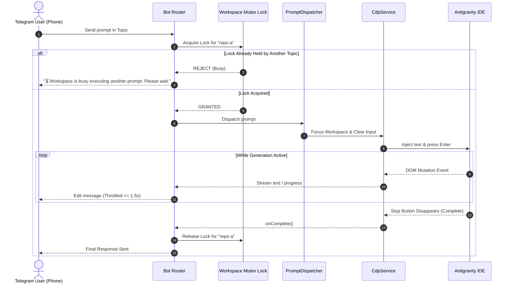

# PRD 02: System Architecture & Design
## Antigravity Telegram

---

### 1. Architectural Philosophy

Antigravity Telegram is engineered around three foundational architectural principles:

1. **Strict Three-Tier Separation**:
   - **CLI / Bootstrapping Tier**: Environment checks, configuration discovery, process lockfile acquisition, daemon management.
   - **Telegram Gateway Tier**: Network long-polling, middleware authentication, input sanitization, message routing, keyboard UI rendering.
   - **Domain / Service & CDP Tier**: Chrome DevTools Protocol WebSocket communication, event-driven DOM mutation observation, SQLite persistence, and concurrency locks.

2. **Decoupled Object-Oriented Services**:
   Each major capability (CDP transport, response monitoring, process management, approval detection, quota evaluation) is isolated into a dedicated service class with explicit dependencies passed via constructor injection.

3. **Event-Driven Over Polling**:
   Where possible, DOM state changes are communicated from the browser via native browser bindings (`window.onAntigravityDomChange`) directly over the CDP WebSocket connection, delivering <100ms update latency and near-zero idle CPU consumption.

---

### 2. High-Level Component Architecture

---

### 3. Layer Responsibilities & Core Classes

#### 3.1. CLI & Process Initialization (`src/bin/`, `src/index.ts`)
- **`acquireLock()`**: Enforces single-instance execution per user environment via a file lock (`/tmp/antigravity-telegram-remote.lock` or OS temp). Automatically verifies if the existing PID is alive before terminating to prevent stale locks.
- **`ConfigLoader`**: Discovers configuration from `.env` or `~/.config/antigravity-telegram-remote/config.json`. Validates required environment variables (`TELEGRAM_BOT_TOKEN`, `ALLOWED_USER_IDS`).
- **`startAction` / `doctorAction` / `setupAction` / `openAction`**:
  - `doctor`: Verifies Node.js version, platform executables, CDP port reachability, and SQLite file permissions.
  - `open`: Detects OS and launches Antigravity with `--remote-debugging-port=<available-port>`.

#### 3.2. Telegram Gateway & Middleware (`src/bot/`, `src/middleware/`)
- **`bot.use(...)` Whitelist Gatekeeper**:
  Inspects `ctx.from.id`. If not in `config.allowedUserIds`, incoming messages and callbacks are dropped immediately.
- **`TelegramTopicManager`**:
  Creates and maintains Telegram Supergroup Forum Topics, binding topic threads (`message_thread_id`) to workspace paths on disk.
- **`StreamMessageFormatter` & `TelegramFormatter`**:
  Converts rich DOM output, Markdown, and ANSI console codes into strict, valid Telegram HTML. Implements emergency closure of open tags (`</code></pre>`) during streaming chunks.

#### 3.3. CDP Integration & Bridge (`src/services/`)
- **`CdpConnectionPool`**:
  Manages persistent WebSocket connections across multiple active Antigravity workspace windows, reusing connections and preventing port exhaustion.
- **`CdpService`**:
  Implements the low-level Chrome DevTools Protocol JSON-RPC envelope over `ws://127.0.0.1:<port>`. Handles:
  - Target discovery (`/json/list`).
  - Focus switching (`Target.activateTarget`).
  - Safe message evaluation (`Runtime.evaluate` & `Input.insertText`).
  - Synthetic input dispatch (`Input.dispatchKeyEvent`).
  - Screenshot streaming (`Page.captureScreenshot`).

#### 3.4. Response Monitor & Stream Engine (`src/services/responseMonitor.ts`)
- **Dual-Stream Strategy**:
  1. **Thinking & Execution Stream**: Captures progress, tool activations, file diff operations, and command executions into a transient status message.
  2. **Final Content Stream**: Formats and streams the assistant's final response text to Telegram.
- **Completion Detection**:
  Watches for the presence/absence of the Antigravity "Stop" button. Requires 3 consecutive confirmation checks across ticks to prevent false completion triggers caused by DOM rendering flickers.
- **Baseline Suppression**:
  Records DOM node checkpoints before prompt injection to avoid echoing previous conversational turns back to the user.

---

### 4. Concurrency & Workspace Isolation

To eliminate race conditions:
1. Prompts sent to the same workspace directory are serialized using an in-memory workspace lock (`Map<string, Promise<void>>`).
2. Two separate Telegram forum topics bound to the same repository directory cannot trigger overlapping prompts.
3. `/stop` resolves the exact workspace bound to the invoking topic, preventing accidental cancellation of unrelated tasks in other workspaces.

---

### 5. Long-Term Daemon Stability & Resource Bounding

To ensure uninterrupted multi-week execution without memory leaks or crashes:
1. **Bounded In-Memory Caches (`BoundedCache<K, V>`)**: Plan contents and pending state maps enforce strict size caps (max 50 items) and sliding TTLs (30m - 1h), automatically evicting oldest items to prevent memory bloat.
2. **Context Deduplication**: `CdpService` tracks `Runtime.executionContextCreated` to avoid duplicating context entries across iframe and web worker lifecycles.
3. **Resilient Message Editing**: Live response streaming balances unclosed tags (`balanceHtmlTags`) when message truncation occurs, with an automatic plain-text fallback (`stripHtml`) to prevent Telegram `Bad Request: can't parse entities` aborts.
4. **Unhandled Rejection Traps**: Global unhandled promise rejection listeners prevent host process crashes during transient network disconnects.
5. **Stale Flag Auto-Purge**: Stop requests auto-expire after 30 seconds and are purged prior to any new prompt dispatch to prevent state contamination.
