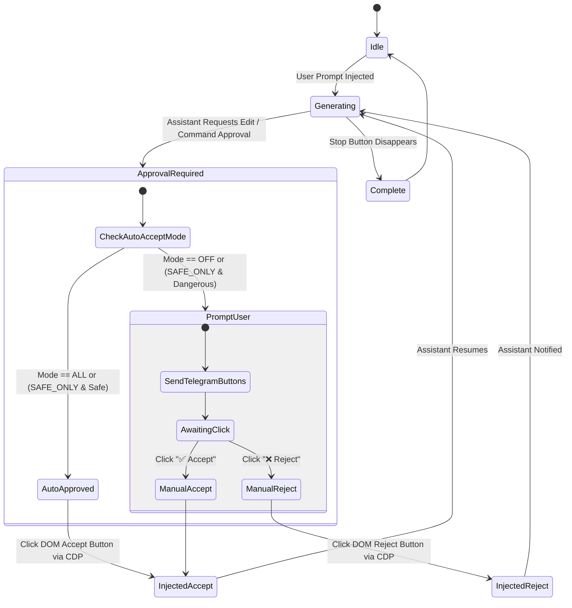

# PRD 03: Functional Specifications
## Antigravity Telegram

---

### 1. Command Catalog & Interactions

All bot interactions occur either via standard slash commands or natural conversational messages sent within Telegram Forum Topics or direct chats.

| Command | Arguments | Context | Description & Behavior |
| :--- | :--- | :--- | :--- |
| `/project` | `[search_term]` | Group / DM | Displays an interactive `InlineKeyboard` listing discovered projects under `WORKSPACE_BASE_DIR`. Selecting a project binds it to the current topic. |
| `/new` | None | Topic / DM | Spawns a brand-new chat session in the active Antigravity workspace window, clearing previous conversational context. |
| `/chat` | None | Topic / DM | Presents a paginated picker showing previous sessions saved for the current workspace. Selecting a session restores it in the IDE. |
| `/model` | None | Any | Displays available LLM models configured in Antigravity (e.g. Gemini Pro, Flash, Claude, etc.) and allows one-tap model switching. |
| `/mode` | None | Any | Toggles Antigravity operation modes (e.g., Code / Architect / Ask / Plan). |
| `/template`| `[name]` | Any | Lists or applies reusable prompt templates from SQLite. Allows swift insertion of frequently used coding prompts. |
| `/stop` | None | Topic / DM | Immediately halts the currently executing prompt in the bound workspace by triggering the Antigravity stop button. |
| `/screenshot` | None | Topic / DM | Captures a high-resolution PNG screenshot of the Antigravity IDE window and delivers it directly to the Telegram thread. |
| `/status` | None | Any | Summarizes system state: active CDP connection, bound workspace, current model, remaining quota, and uptime. |
| `/autoaccept` | None | Any | Toggles auto-accept mode (`ALL`, `SAFE_ONLY`, `OFF`) for approving file edits, command runs, and plan steps without manual taps. |
| `/cleanup` | `[days]` | Any | Displays an interactive menu to purge old sessions, orphan bindings, and logs older than the specified retention window (default: 30 days). |
| `/help` | None | Any | Shows a human-crafted cheat sheet of commands, keyboard shortcuts, and tips. |

---

### 2. Telegram Forum Topics & Multi-Workspace Isolation

#### 2.1. Supergroup Topic Mode (`USE_TOPICS=true`)
When operating within a Telegram Supergroup with Forum Topics enabled:
- **Automatic Binding**: Each created topic is persistently bound to a specific subfolder of `WORKSPACE_BASE_DIR` in the SQLite database (`workspace_bindings`).
- **Context Preservation**: Any plain text message, voice note, or photo sent within that topic is automatically dispatched to the bound workspace without needing to specify `/project` each time.
- **Title Synchronization**: When a new session is started, `TitleGeneratorService` generates a concise topic title reflecting the task and renames the Telegram topic via Telegram Bot API (`editForumTopic`).

#### 2.2. Direct Message / Non-Topic Fallback (`USE_TOPICS=false`)
- In standard direct messages or single-channel groups, the bot tracks the user's "Active Workspace" in SQLite.
- Users switch between workspaces using `/project`.

---

### 3. Multi-Modal Input Processing

#### 3.1. Voice Notes & Audio Messages (`src/utils/voiceHandler.ts`)
- **Pipeline**:
  1. Telegram user records a voice note (`.oga` / `.ogg` Opus format).
  2. Bot downloads audio via `getFile` to a secured temporary directory (`/tmp/antigravity-telegram-remote-voice`).
  3. Validates file size and MIME type.
  4. Dispatches audio to local `whisper.cpp` (`base.en` or multilingual model) using `ffmpeg-static` for PCM WAV decoding.
  5. Strips whisper timestamp tokens (e.g. `[00:00.000 --> 00:02.000]`).
  6. Automatically deletes the temporary audio file immediately in a `finally` block.
  7. Forwards the transcribed text directly to `PromptDispatcher`.
- **Zero Cloud Leakage**: Audio data is never transmitted to any third-party speech API.

#### 3.2. Image & Screenshot Attachments (`src/utils/imageHandler.ts`)
- **Pipeline**:
  1. User attaches a photo or screenshot to a Telegram message.
  2. Bot downloads the image payload into memory / temporary buffer.
  3. Validates image dimensions and MIME type (`image/png`, `image/jpeg`, `image/webp`).
  4. Injects the image file into Antigravity's active chat session using the CDP DOM file upload selector or clipboard simulation.

---

### 4. Real-Time Streaming & Dual-Stream Output

#### 4.1. Stream Separation
Antigravity's output is split into two distinct visual channels:
1. **Status / Activity Message (Transient)**:
   - Displays real-time phase transitions: `Thinking...`, `Editing src/services/cdpService.ts`, `Running npm test`.
   - Displays elapsed execution time (`⏱️ 42s`).
   - Displays current tool execution and diff snippets.
2. **Assistant Content Message (Final Output)**:
   - Streams the actual conversational prose and generated code blocks.
   - Updated incrementally with a throttling window ($\ge 1.5$ seconds) to comply with Telegram API rate limits.

#### 4.2. HTML Formatting & Escape Safety
- All streaming chunks are processed through `htmlToTelegramMarkdown.ts` / `telegramFormatter.ts`.
- **Entity Escaping**: Literal `<`, `>`, `&` are converted to `&lt;`, `&gt;`, `&amp;`.
- **Tag Closure Invariants**: If a message chunk cuts off inside an open `<pre><code>` block, the formatter automatically injects `</code></pre>` at the boundary and reopens it on the subsequent edit.

---

### 5. Interactive Approvals & Auto-Accept System

- **Approval Detection (`src/services/approvalDetector.ts`)**:
  Scans DOM elements using scored selectors to identify pending file write confirmations or terminal command execution prompts.
- **Telegram Notification**:
  Sends a high-priority Telegram message containing the proposed file path, diff preview, or shell command, accompanied by an `InlineKeyboard`:
  - `[ ✅ Approve ]`
  - `[ ❌ Reject ]`
  - `[ ⚡ Auto-Accept (This Turn) ]`
- **Auto-Accept Service (`src/services/autoAcceptService.ts`)**:
  Allows users to toggle automated approvals when running trusted batches of tests or refactorings.

---

### 6. Quota & Token Management (`src/services/quotaService.ts`)

- Monitors Antigravity's remaining monthly / daily token quotas directly from the IDE's UI state.
- Emits proactive warnings in Telegram when quota drops below 15% and 5%.
- Prevents infinite loops or runaway generations if token limits are reached.
