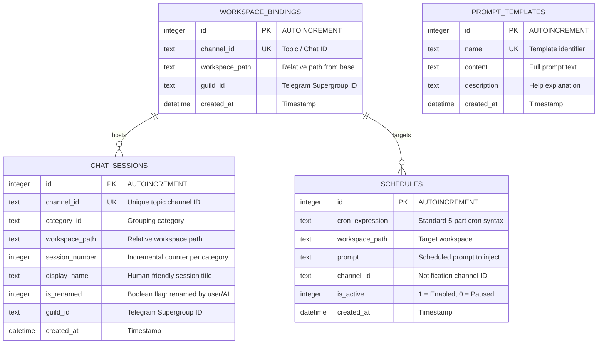

# PRD 05: Data Architecture & Persistence
## Antigravity Telegram Remote (ANTIRLM)

---

### 1. Storage Overview

ANTIRLM relies on **SQLite 3** via the high-performance native binding `better-sqlite3`. SQLite provides zero-configuration, ACID-compliant, single-file embedded storage (`antigravity.db`) that operates synchronously with zero network overhead.

---

### 2. Entity-Relationship Model



---

### 3. Detailed Table Schemas

#### 3.1. `workspace_bindings`
Binds Telegram Forum Topics (or direct message chats) to physical project directories on the workstation.

```sql
CREATE TABLE IF NOT EXISTS workspace_bindings (
    id INTEGER PRIMARY KEY AUTOINCREMENT,
    channel_id TEXT NOT NULL UNIQUE,
    workspace_path TEXT NOT NULL,
    guild_id TEXT NOT NULL,
    created_at DATETIME DEFAULT CURRENT_TIMESTAMP
);

CREATE INDEX IF NOT EXISTS idx_workspace_bindings_guild 
ON workspace_bindings(guild_id);

CREATE INDEX IF NOT EXISTS idx_workspace_bindings_path_guild 
ON workspace_bindings(workspace_path, guild_id);
```

#### 3.2. `chat_sessions`
Tracks conversational sessions created in Antigravity per workspace, enabling switching between sessions with `/chat`.

```sql
CREATE TABLE IF NOT EXISTS chat_sessions (
    id INTEGER PRIMARY KEY AUTOINCREMENT,
    channel_id TEXT NOT NULL UNIQUE,
    category_id TEXT NOT NULL,
    workspace_path TEXT NOT NULL,
    session_number INTEGER NOT NULL,
    display_name TEXT,
    is_renamed INTEGER DEFAULT 0,
    guild_id TEXT NOT NULL,
    created_at DATETIME DEFAULT CURRENT_TIMESTAMP
);

CREATE INDEX IF NOT EXISTS idx_chat_sessions_category 
ON chat_sessions(category_id);

CREATE INDEX IF NOT EXISTS idx_chat_sessions_lookup 
ON chat_sessions(workspace_path, display_name);
```

#### 3.3. `prompt_templates`
Stores reusable coding prompts and instructions for swift insertion via `/template`.

```sql
CREATE TABLE IF NOT EXISTS prompt_templates (
    id INTEGER PRIMARY KEY AUTOINCREMENT,
    name TEXT NOT NULL UNIQUE,
    content TEXT NOT NULL,
    description TEXT,
    created_at DATETIME DEFAULT CURRENT_TIMESTAMP
);
```

#### 3.4. `schedules`
Manages automated, recurring cron jobs (e.g. running code linting or test summaries every morning).

```sql
CREATE TABLE IF NOT EXISTS schedules (
    id INTEGER PRIMARY KEY AUTOINCREMENT,
    cron_expression TEXT NOT NULL,
    workspace_path TEXT NOT NULL,
    prompt TEXT NOT NULL,
    channel_id TEXT NOT NULL,
    is_active INTEGER DEFAULT 1,
    created_at DATETIME DEFAULT CURRENT_TIMESTAMP
);
```

---

### 4. Statement Caching & Prepared Execution

To eliminate SQL compilation overhead and prevent memory leaks:
1. Each repository prepares all SQL statements once during construction (`this.stmtCreate = this.db.prepare(...)`).
2. Statements are stored in private readonly fields and reused across all operations.
3. Positional parameters (`?`) ensure type safety and total immunity to SQL injection.

---

### 5. Single-Instance Concurrency Lock (`src/utils/lockfile.ts`)

To prevent multiple bot instances from running simultaneously against the same Telegram Bot token and database:
1. **PID Lockfile**: Writes the running process PID to `antigravity-telegram-remote.lock` in the OS temporary directory.
2. **Stale Lock Detection**: Before aborting on an existing lockfile, checks if the recorded PID is actively running using `process.kill(pid, 0)`. If the process is dead, the stale lock is safely reclaimed.
3. **Graceful Cleanup**: Registers handlers on `SIGINT`, `SIGTERM`, and `exit` to remove the lockfile automatically.

---

### 6. Retention & Cleanup Protocol (`/cleanup`)

- **Automated Pruning**:
  Users can execute `/cleanup [days]` to purge chat sessions, temporary files, and stale bindings older than $N$ days (default: 30).
- **SQLite VACUUM**:
  Post-cleanup execution triggers `VACUUM` to reclaim unused disk space and optimize B-Tree page allocation.
